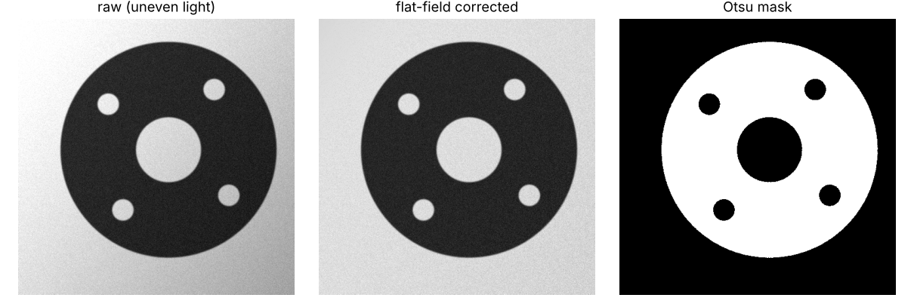
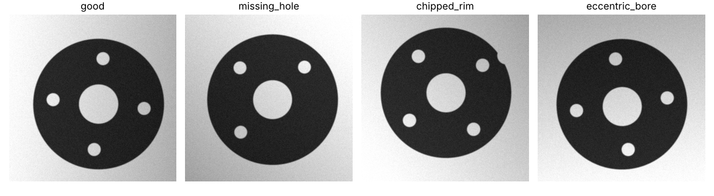

# Machine-Vision Metrology and Defect Inspection of a Machined Flange (OpenCV)

A classical inspection pipeline for a flange (outer disk, central bore, four bolt holes on a pitch circle) that measures
dimensions to **micrometre-level accuracy at 100 µm per pixel** and flags four defect classes, evaluated on rendered
images with exact ground truth.

**Pipeline:** flat-field correction (plane fit to the background) → Otsu threshold → contour hierarchy (part, bore, holes) →
**sub-pixel edge localisation** along the intensity gradient → robust geometric circle fits → outer/bore/hole diameters,
pitch-circle diameter, bore eccentricity, rim roundness → rule-based verdict with tolerances.

**Images:** 512 × 512 back-lit renders with 4× supersampled edges, random pose, ±0.05 mm part-to-part variation, illumination
gradients, defocus blur and sensor noise; defects: missing bolt hole, chipped rim (0.5–1.5 mm deep), eccentric bore (0.6–1.5 mm).

## Results

**Measurement error** (mean absolute error in µm, 40 good parts per row; 1 px = 100 µm)

| Noise σ / blur | Contours | Outer Ø | Bore Ø | Hole Ø | Pitch-circle Ø | Bore offset |
|---|---|---|---|---|---|---|
| 0.01 / 0.5 px | **sub-pixel** | **1.6** | **1.5** | 6.0 | 0.4 | 1.9 |
| 0.01 / 0.5 px | pixel | 91.3 | 91.1 | 89.7 | 3.4 | 2.8 |
| 0.06 / 1.5 px | sub-pixel | 6.9 | 3.5 | 11.0 | 2.1 | 22.1 |
| 0.10 / 3.0 px | sub-pixel | 11.7 | 12.1 | 42.6 | 6.0 | 57.7 |
| 0.10 / 3.0 px | pixel | 252.1 | 238.4 | 207.2 | 15.3 | 37.2 |

- Sub-pixel edges cut diameter error **~60×** (91 → 1.6 µm, i.e. 1/60 of a pixel). Pixel contours sit on the boundary of
  thresholded pixels, which biases every diameter by about one pixel; centre-based quantities (pitch circle, offset) are less affected.
- **Repeatability** (same part, 30 noisy images): standard deviation 2.3 µm (outer Ø), 2.5 µm (bore Ø), 1.0 µm (pitch circle).
- **Defect classification: 100%** for all four classes at every noise level (80 test parts per class). A random forest on
  64 × 64 downsampled pixels trained on 600 images stays at chance (24–27%): with random pose and small defects, raw pixels
  are the wrong representation — geometry is the right one.
- 56 ms per image in Python/OpenCV.




Full tables: [`results/summary.md`](results/summary.md)

## Run
```bash
pip install -r requirements.txt
python -m unittest discover -s tests -v
python scripts/run_experiments.py     # ~12 min (rendering at 4x supersampling)
```
